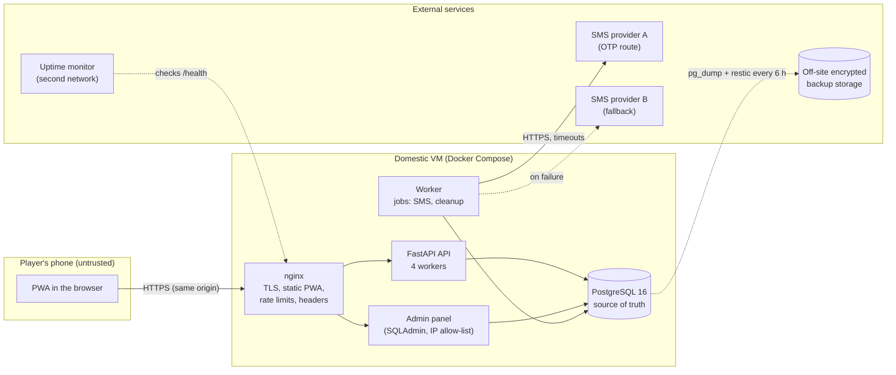
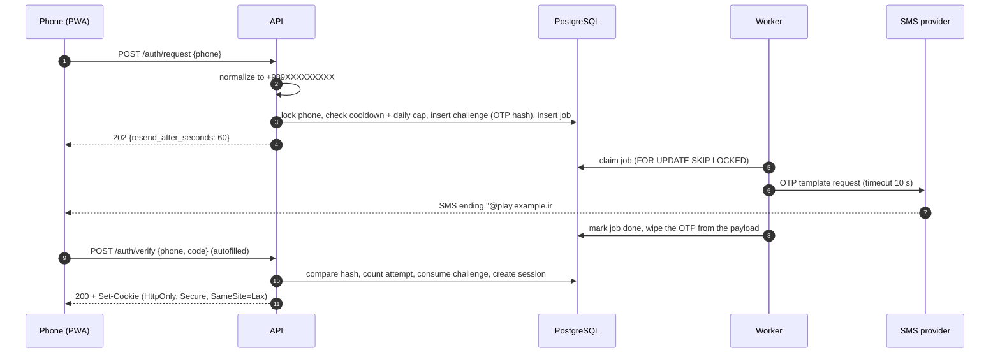
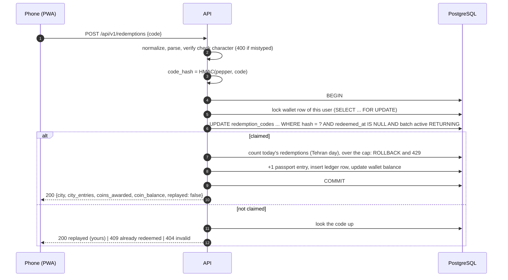
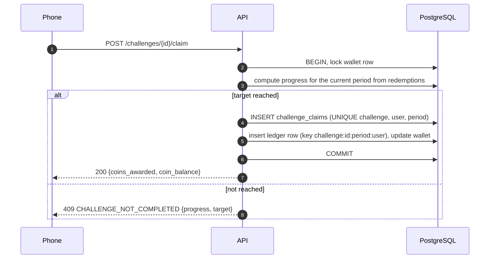
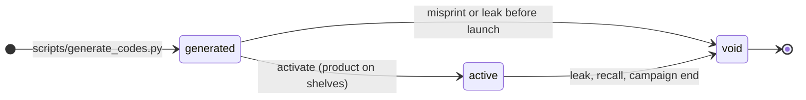
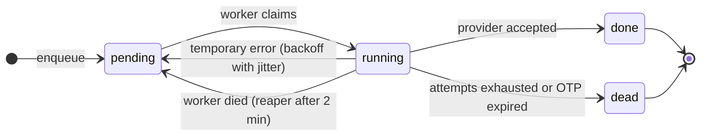
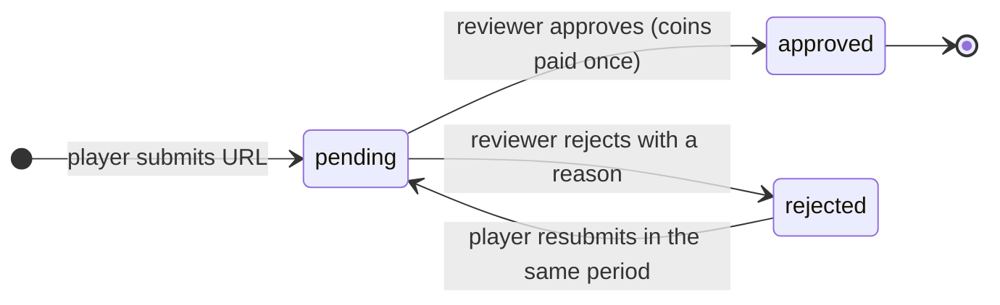

# Architecture

How the MVP is built, why, and what to revisit as it grows. Decisions with real trade-offs
have their own record in [adr/](adr/). Security is in [SECURITY.md](SECURITY.md), running
it in production is in [OPERATIONS.md](OPERATIONS.md).

## Contents

- [Requirements](#requirements)
- [Capacity estimate](#capacity-estimate)
- [System overview](#system-overview)
- [Code structure](#code-structure)
- [Data model](#data-model)
- [Key flows](#key-flows)
- [Invariants and how they are enforced](#invariants-and-how-they-are-enforced)
- [Time](#time)
- [Caching](#caching)
- [Failure modes](#failure-modes)
- [What to revisit as it grows](#what-to-revisit-as-it-grows)

## Requirements

**Functional (MVP)**

- Sign in with an Iranian mobile number and a one-time SMS code.
- Redeem a printed code (scanned QR or typed): +1 entry in that city's draw, +N coins.
- See your passport (entries per city) and wallet (balance, history).
- Daily and weekly challenges: automatic ones computed from your redemptions, manual ones (social post, staff-verified task) approved in the admin panel.
- Weekly leaderboards per lounge and overall.
- Short tournaments whose results staff enter and the system pays in coins.
- Admin panel for marketing and lounge staff, with an audit trail.

**Non-functional**

| Quality | Target for the MVP |
|---|---|
| Correctness | No code ever pays twice; no coin movement without a ledger row; balances never negative |
| Availability | 99.5% during lounge opening hours; planned maintenance outside them |
| Latency | p99 under 500 ms for redemption at the expected peak (measured, see [TESTING.md](TESTING.md#load-test)) |
| Recovery | RPO 6 hours or better (backup interval), RTO 2 hours (restore drill proves it) |
| Security | Codes unguessable; OTP not brute-forceable; admin actions attributable |
| Locality | Works when international connectivity is cut: everything on the request path is hosted in Iran |

**Constraints**: one backend developer, one external frontend developer, 15 days, a small
budget, Iranian hosting and payment ecosystem, sanctions-affected foreign services.

## Capacity estimate

The numbers are assumptions; replace them with the lounges' real figures (M05) and measure.

| Quantity | Assumption | Consequence |
|---|---|---|
| Players at the three lounges | ~1,200 visits per day, ~450 concurrent at the evening peak | Tiny for PostgreSQL |
| Registered users after 3 months | 10,000–50,000 (more if codes are on nationwide retail packs) | One table scan of users is still milliseconds |
| Peak request rate | 450 active phones x 1 request every 5 s = ~90 req/s; design for 5x = **~450 req/s** | One 4 vCPU VM with 4 API workers has headroom; load test proves it |
| Codes | 7 cities x 500,000 = 3.5 M rows, ~1.5 GB with indexes | Fits in RAM on an 8 GB VM; index lookups by hash |
| Ledger | ~5 rows per active user per day | Under 10 M rows in a season |

The expensive part of this system is not traffic, it is **trust**: every code and coin must
be right, and every action must be explainable afterwards.

## System overview



- **Same origin**: nginx serves the built PWA and proxies `/api/` to FastAPI on one domain, so there is no CORS, the session cookie is first-party, and a strict CSP is easy.
- **One VM, four containers** (nginx, api, worker, postgres). No Redis, no message broker, no Kubernetes in the MVP: [ADR 0004](adr/0004-postgres-only-no-redis-for-mvp.md), [ADR 0006](adr/0006-domestic-single-vm-docker-compose.md).
- **The worker** takes anything slow or external off the request path (SMS today; cleanup and reports later) through a `jobs` table in PostgreSQL.
- **Staging** is the same shape on a smaller VM with its own database, secrets and SMS sender.

## Code structure

Hexagonal ("ports and adapters"), already established in this repository. Dependencies point inward.

```text
app/
  domain/              pure rules, no frameworks
    codes.py           code format registry, city2-b9 default (v2-b10 also
                       registered), normalization, check (done)
    code_batches.py    batch lifecycle                                                 (done)
    ledger.py          coin ledger entry types                               (done)
    passports.py       cities, campaigns, entries per code
    users.py, authentication.py
    phones.py          Iranian mobile normalization                          (B10)
    periods.py         Tehran day/week keys for challenges and leaderboards  (B17)
  application/         use cases and ports (Protocols); no SQLAlchemy/FastAPI
    unit_of_work.py    one-transaction ports for multi-table writes          (done)
    redemption_codes.py, wallets.py, passports.py                            (done)
    authentication.py  phone OTP sign-in                                     (B10)
    jobs.py            enqueue/claim/complete jobs                           (B11)
    challenges.py, submissions.py, leaderboards.py, tournaments.py           (B17-B22)
  infrastructure/
    postgres/          models, read repositories, unit_of_work.py (writes)
    sms/               provider adapters + console adapter for development   (B11)
  api/                 FastAPI routers, schemas, error envelope, dependencies
  admin/               SQLAdmin views, admin auth, audit hooks               (B20)
  worker.py            jobs loop entry point                                 (B11)
  app.py               composition root: builds adapters, injects services
scripts/               generate_codes.py, code_batches.py                     (done)
deploy/                production Compose file, nginx config, backup script
alembic/versions/      one migration per schema change, never on startup
tests/unit/            domain and use cases with in-memory fakes
tests/integration/     PostgreSQL: constraints, transactions, concurrency, API
```

Two pragmatic rules for the 15 days, so the architecture helps instead of slowing you down:

1. **Writes that touch more than one table go through a unit of work** (`app/application/unit_of_work.py`). That is where correctness lives; give it ports, fakes and tests.
2. **Simple reads and admin CRUD do not need a port per table.** A read repository or a SQLAdmin view is enough. Add an abstraction when a second real caller appears.

## Data model

Tables marked *planned* are specified here so the frontend contract and the admin panel can be
built against them; they arrive with the TODO item named.

```mermaid
erDiagram
    users ||--o{ auth_sessions : has
    users ||--o{ authentication_challenges : requests
    users ||--o| wallets : owns
    users ||--o{ coin_ledger_entries : "is credited"
    users ||--o{ passport_progress : collects
    users ||--o{ redemption_codes : redeems
    code_batches ||--|{ redemption_codes : contains
    venues ||--o{ users : "home of"
    challenges ||--o{ challenge_claims : "claimed in"
    users ||--o{ challenge_claims : makes
    challenges ||--o{ submissions : receives
    users ||--o{ submissions : sends
    venues ||--o{ tournaments : hosts
    tournaments ||--o{ tournament_results : has
    users ||--o{ tournament_results : places

    users {
        uuid id PK
        string identifier UK "E.164 mobile (B10)"
        string display_name "nickname"
        uuid home_venue_id FK "planned B15"
        string terms_version "planned B15"
    }
    code_batches {
        uuid id PK
        string city
        int coins_per_code
        string status "generated, active, void"
        string format_id "registered format; default city2-b9"
        string format_fingerprint "set at freeze; guards against spec drift"
        timestamptz exported_at
        string export_sha256
        timestamptz frozen_at
    }
    redemption_codes {
        uuid id PK
        string code_hash UK "HMAC-SHA256, never plaintext"
        uuid batch_id FK
        uuid redeemed_by_user_id FK
        timestamptz redeemed_at
    }
    passport_progress {
        uuid user_id FK
        string campaign
        int points "entries in that city's draw"
    }
    wallets {
        uuid user_id PK
        bigint balance "CHECK >= 0"
        bigint lifetime_earned
    }
    coin_ledger_entries {
        bigint id PK
        uuid user_id FK
        bigint amount "never 0"
        string reason
        string idempotency_key UK
    }
    venues {
        int id PK
        string slug UK
        string name
    }
    challenges {
        uuid id PK
        string kind "redeem_count, distinct_cities, manual, social_post"
        string period "day, week, once"
        int target
        int reward_coins
    }
    challenge_claims {
        uuid challenge_id FK
        uuid user_id FK
        string period_key "UNIQUE with challenge and user"
    }
    submissions {
        uuid id PK
        string url
        string status "pending, approved, rejected"
    }
    tournaments {
        uuid id PK
        int venue_id FK
        string game
        string status
    }
    tournament_results {
        uuid tournament_id FK
        int place "PK with tournament"
        uuid user_id FK
        int coins
    }
```



Not drawn, all *planned*: `audit_log` (actor, action, entity, JSON diff, IP, time), `jobs` (kind, payload, status,
run_at, attempts, expires_at), `redemption_failures` (user, IP, time; for the throttle),
`role_change_events` (actor, target user, from_role, to_role, reason, when — append-only;
see T1.1b in the implementation plan).

Note: `users.role` (`player`, `staff`, `marketing`, `admin`) arrives with migration 0007
(T1.1b). The `code_batch_events` append-only table (event_type, batch_id, actor, recorded_at)
already exists from migration 0006.

**Data dictionary highlights**

| Column | Meaning and rule |
|---|---|
| `redemption_codes.code_hash` | `HMAC-SHA256(pepper, canonical code)`. The pepper lives only in the environment. Unique. |
| `redemption_codes.batch_id` | A code is redeemable only while its batch is `active`. Rows from before migration 0005 have no batch and can never be redeemed. |
| `passport_progress.points` | Entries in that city's draw. Each comes from one redeemed code, so the redeemed rows in `redemption_codes` are the audit trail for entries. |
| `coin_ledger_entries.idempotency_key` | One key per logical award: `code_redemption:<code id>`, `challenge:<id>:<period>:<user>`, `tournament:<id>:<place>`, `adjustment:<uuid>`. Unique, so an award can never be recorded twice. |
| `coin_ledger_entries` | Append-only (trigger). Corrections are new entries with `reason = admin_adjustment`. |
| `wallets.balance` | Cached sum of the user's ledger, updated in the same transaction as each entry. Reconcile with `SUM(amount)` (query in [OPERATIONS.md](OPERATIONS.md#daily-checks)). |
| `challenge_claims.period_key` | `D:2026-10-10` for a Tehran day, `W:2026-10-10` for the week starting that Saturday, `ONCE` for one-off challenges. |

## Key flows

### Sign in with SMS (B10, B11)



### Redeem a code (done)



A rival transaction trying to claim the same code blocks on the row lock, then re-checks
`redeemed_at IS NULL` after the winner commits and finds nothing. This is proven by
`tests/integration/test_redemption_flow.py`, including a deterministic lock-wait test.

### Claim a challenge (B17)



### Lifecycles







## Invariants and how they are enforced

| Invariant | Enforced by | Proven by |
|---|---|---|
| One code is redeemed at most once | Conditional `UPDATE ... WHERE redeemed_at IS NULL`; unique `code_hash` | Concurrency tests (many users, one code; deterministic lock wait) |
| One award is credited at most once | Unique `coin_ledger_entries.idempotency_key` | `test_idempotency_key_is_enforced_by_the_database` |
| Claim, entries, ledger and balance change together or not at all | One unit of work per use case | `test_daily_limit_rolls_back_the_claim...`, integration tests |
| Balances never go negative | `CHECK (balance >= 0)` + conditional update | `test_spending_more_than_the_balance_is_refused...` |
| Ledger history is never edited | `BEFORE UPDATE OR DELETE` trigger | `test_ledger_rows_cannot_be_updated_or_deleted` |
| Daily cap holds under concurrent requests | Wallet row lock serializes one user's redemptions | `test_daily_limit_holds_under_concurrent_requests` |
| A voided batch stops working immediately | Batch status checked inside the claim statement | `test_codes_work_only_while_their_batch_is_active` |
| A challenge pays once per period | `UNIQUE (challenge_id, user_id, period_key)` + ledger key (B17) | to write with B17 |
| Staff cannot quietly change balances | Adjustments are ledger rows with `actor_id`; audit log (B20) | to write with B20 |
| A frozen format spec never drifts silently | `verify_frozen_formats` on startup; fails loudly on mismatch | `test_startup_fails_if_frozen_format_drifts` (integration) |

## Time

- Store every instant as `timestamptz` in UTC. Containers and the database session run in UTC.
- Game days and weeks are **Tehran** days and weeks (`CAMPAIGN_TIMEZONE=Asia/Tehran`, UTC+03:30, no daylight saving time since 2023). Weeks start on **Saturday 00:00**.
- Compute "today" and "this week" on the server and send the keys to the client in `GET /config`; never trust the phone's clock or its time-zone database (old phones may still apply the abolished DST).
- The `tzdata` Python package is a dependency so the zone data is present even in slim images.
- Durations, timeouts and rate windows use a monotonic clock in-process, or database time in SQL.
- Show Jalali dates in the UI (the frontend converts); the API speaks ISO 8601.

## Caching

- **Nothing that decides correctness is cached.** Code state, balances and claims always come from PostgreSQL.
- Cached for 30–60 seconds, in each API process: leaderboards, `GET /config`, challenge definitions.
- nginx caches nothing under `/api/`. Static PWA files are fingerprinted and cached for a year; `index.html` is not cached.
- Add Redis only when a measured need appears (shared rate limits across several API servers, or leaderboards too slow to compute): [ADR 0004](adr/0004-postgres-only-no-redis-for-mvp.md).

## Failure modes

| What fails | What players see | What the system does | What you do |
|---|---|---|---|
| SMS provider A down or slow | Code arrives late or by provider B | Worker retries with backoff, switches to provider B; OTP jobs older than the OTP lifetime are dropped | Runbook [SMS outage](OPERATIONS.md#runbook-sms-provider-outage) |
| Worker process down | New sign-ins wait for their SMS | Jobs queue up in PostgreSQL; nothing is lost | Alert on queue age; restart the worker |
| PostgreSQL down | Error screen; nothing can be redeemed | API returns 503; `/ready` fails | Runbook [database down](OPERATIONS.md#runbook-database-down-or-disk-full) |
| International internet cut | Nothing changes for players in Iran | Everything on the request path is domestic | Check that off-site backups and alerts still work |
| Traffic spike or bot flood | Some requests get 429 with `Retry-After` | nginx limits per IP (lounge IPs allow-listed) and per account limits in the API | Runbook [overload or attack](OPERATIONS.md#runbook-overload-or-attack) |
| Printer file leaked | Unknown people redeem codes | Batch can be voided in seconds | Runbook [code leak](OPERATIONS.md#runbook-suspected-code-leak) |
| Bad deploy | Errors after a release | Previous image tag still on the VM | Roll back (`deploy.sh <previous tag>`); migrations are additive during the campaign |

## What to revisit as it grows

| Trigger | Change |
|---|---|
| More than ~1,500 req/s sustained, or CPU above 70% at peak | Second API VM behind the same nginx (or a load balancer), shared rate limits in Redis |
| Leaderboard query above ~100 ms | Pre-aggregate weekly totals in a table updated in the same transaction as ledger inserts |
| Data loss tolerance below 6 hours | PostgreSQL WAL archiving (point-in-time recovery) or a streaming replica |
| More than ~10 job kinds or high job volume | A dedicated queue library on PostgreSQL (for example Procrastinate) before considering a broker |
| A second campaign with different rules | Campaign and scoring configuration tables ([BUILD_SPEC.md](BUILD_SPEC.md) sections 6 and 14), instead of constants |
| Real-money purchases or a national rollout | A threat-model review, an external penetration test, and a second engineer on call |
