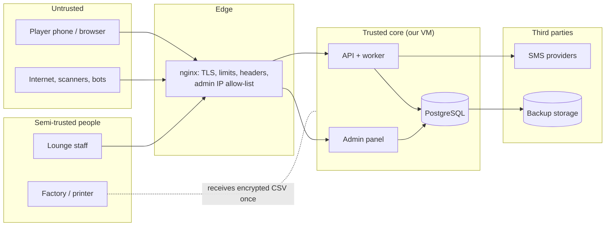

# Security

Threat model, controls and checklists for the MVP. The attacker we design for is not a
nation state; it is a bored, skilled 19-year-old with a script, 30 SIM cards, a Telegram group,
and a trip to Europe as motivation. Also: insiders with good intentions and bad habits.

Item IDs (B10, B19, ...) refer to [TODO.md](TODO.md).

## Contents

- [What we protect](#what-we-protect)
- [Trust boundaries](#trust-boundaries)
- [Threats and controls](#threats-and-controls)
- [Authentication and sessions](#authentication-and-sessions)
- [User-generated text](#user-generated-text)
- [Admin panel](#admin-panel)
- [Secrets inventory](#secrets-inventory)
- [Logging and privacy](#logging-and-privacy)
- [Pre-launch security checklist](#pre-launch-security-checklist)

## What we protect

| Asset | Why it matters | Where it lives |
|---|---|---|
| Unredeemed printed codes | Each is an entry in a trip draw plus coins | Hashes in PostgreSQL; plaintext only in the printer CSV until it is destroyed |
| The redemption pepper | With the pepper and a database dump, codes become guessable offline | Environment variable; password manager |
| Coin balances and the ledger | Prizes; trust in fairness | PostgreSQL |
| Player data: mobile numbers, nicknames | Privacy; many players are teenagers | PostgreSQL, backups |
| Sessions and OTPs | Account takeover | Hashes in PostgreSQL; cookie in the player's browser |
| Admin accounts | Can approve, adjust, void | `users.role = admin` (phone sign-in), B20 |
| Backups | Contain all of the above | Off-site encrypted repository |

## Trust boundaries

Everything that crosses into the core is validated there, even from staff and even from our own frontend.

## Threats and controls

| # | Threat | Controls | Status |
|---|---|---|---|
| T1 | **Guessing codes** with scripts across many accounts | 50 random bits per code (1 valid in ~2.25 billion guesses at 500k codes per city); check character rejects typos without a lookup; per-account throttle on invalid codes; alert on the global `CODE_INVALID` rate | Format ✅; throttle B19; alert B26 |
| T2 | **Harvesting codes** from closed products (shelves, vending machine window, warehouse) | Code invisible until opened (Q1); batches redeemable only after activation | Q1 (Mehdi + factory) |
| T3 | **Printer file leaks** (email, USB stick, factory PC) | One CSV per batch, created 0600, encrypted for transfer, SHA-256 confirmation, written deletion confirmation; batch stays `generated` until launch; void kills it | ✅ tooling; process in [CODES.md](CODES.md#handing-codes-to-the-printer) |
| T4 | **Database dump stolen** | Codes stored as HMAC with a pepper outside the database; OTPs and session tokens hashed; backups encrypted | ✅ codes/sessions; OTP keyed hash B10 |
| T5 | **Account farming** (many SIM cards, one person) | One account per mobile number; daily caps; weekly leaderboard reviewed by a human before any prize; identity check (mobile number matched to national ID) at prize claim; one prize per person | Caps ✅; review process B30; identity check Phase 2 |
| T6 | **SMS pumping** (attacker triggers thousands of SMS to drain credit) | 60 s cooldown and daily cap per number; nginx limit per IP on `/api/v1/auth/request`; global hourly SMS ceiling that pauses sending and alerts; provider spend alert | B10, B11, B25, B26 |
| T7 | **OTP brute force** | 6 digits, 5 attempts per code, 2–3 minute lifetime, daily cap per number; constant-time comparison; generic error | Attempts ✅ (existing code); rest B10 |
| T8 | **Session theft** | Random 256-bit token, only its hash stored; HttpOnly + Secure + SameSite=Lax cookie; HTTPS only with HSTS; logout and bans revoke instantly | ✅ (existing); HSTS B25 |
| T9 | **CSRF** | Same-origin API; SameSite=Lax; state-changing endpoints accept only `application/json`; reject requests whose `Origin` is not our domain | Origin check B25 |
| T10 | **XSS through nicknames or URLs** | Nickname allow-list (below); submission URLs parsed and re-built from an allow-listed pattern; React escaping; strict CSP (no inline scripts); no `dangerouslySetInnerHTML` | B15, B18, A15 |
| T11 | **Unicode tricks** (right-to-left override, zero-width characters, look-alike letters) in nicknames | Rules in [User-generated text](#user-generated-text) | B15 |
| T12 | **Reading other players' data** (IDOR) | Player endpoints use the session's user only (`/me/...`); no user IDs in player URLs | ✅ pattern; keep it |
| T13 | **Admin account compromise** | `admin` role granted only from the command line, fresh SMS code and a separate 1-hour admin cookie for the panel, IP allow-list in nginx, role re-checked per request, audit log; TOTP optional later | B20 |
| T14 | **Insider abuse** (coins for friends, fake approvals, tournament results for a cousin) | Every coin movement is a ledger row with the admin's ID and a reason; admin adjustments do not count on leaderboards; daily report of adjustments and approvals by person; public tournament results | Ledger ✅; B20, B21, B26 |
| T15 | **Collusion and bots on leaderboards** | Rank by coins earned, not balance; human review of the top 20 before prizes; anomaly queries (many accounts sharing a device or a non-lounge IP) | B21, B30 |
| T16 | **Denial of service / floods** | nginx `limit_req`, request body size limit, timeouts; FastAPI workers bounded; PostgreSQL `statement_timeout`; a domestic CDN/WAF in front if attacked | B25 |
| T17 | **Supply chain** (malicious or swapped packages, mirrors) | `uv.lock` with hashes and `uv sync --locked`; one package index, never `--extra-index-url`; images pinned by digest; `npm ci`; pip-audit and gitleaks in CI | Lock ✅; CI additions B25 |
| T18 | **Secrets in git or chat** | `.env` ignored; secrets only in a password manager; gitleaks over history | B25 |
| T19 | **Codes or phone numbers in logs** | API logs no bodies; nginx log format redacts `/r/<code>`; phone numbers masked in application logs | Partly ✅; nginx B25 |
| T20 | **Disputed draw** ("it was rigged") | Published entry-snapshot hash before the draw, public seed, reproducible script, witnesses ([DRAW.md](DRAW.md)) | Phase 3 |

## Authentication and sessions

- Players sign in with a mobile number and a 6-digit SMS code ([ADR-0005](adr/0005-phone-otp-server-side-sessions.md)). Responses never reveal whether a number is registered.
- OTP rules (B10): lifetime 150 seconds, 5 verification attempts per code, 60 s cooldown before a new code, at most 8 codes per number per Tehran day. The code is stored as `HMAC-SHA256(server secret, challenge id + code)`, never in plaintext except inside the SMS job until it is sent (then wiped).
- Successful verification creates a session: a random token in an HttpOnly, Secure, SameSite=Lax cookie; only `SHA-256(token)` is stored. Sessions last 30 days; logout and account suspension revoke them.
- Machine-to-machine `X-API-Key` (already in the code) is for server-side integrations only. It is never used by the browser.

## User-generated text

Nicknames are public on leaderboards and lounge screens, so they are the main injection surface.

1. Normalize to NFC; trim; collapse internal whitespace.
2. Allowed characters: Latin letters, digits, `_` `.` `-`, Persian letters, and the zero-width non-joiner (U+200C, needed in Persian words) but never at the start, end, or twice in a row.
3. Reject: bidirectional control characters (U+202A–U+202E, U+2066–U+2069, U+200E, U+200F), other zero-width characters (U+200B, U+200D, U+FEFF), emoji, and anything else not allowed above.
4. Length 3–16 characters (the API contract's limit; every allowed character is a single code point, so this equals grapheme clusters).
5. Uniqueness on a comparison key: case-folded, Arabic yeh/kaf mapped to Persian (`ي`→`ی`, `ك`→`ک`), so `Ali` and `ALI` are one name.
6. Reserved names: `admin`, `support`, staff names, brand and lounge names; a short profanity list (Persian and English) maintained by Mehdi.

Submission URLs: parse, accept only `https://instagram.com` or `https://www.instagram.com` with a `/p/<id>/` or `/reel/<id>/` path, drop query and fragment, store the rebuilt URL. Never fetch the URL from the server (it would be blocked and it is a server-side request forgery risk anyway).

## Admin panel

- Reachable only from allow-listed IPs (office, VPN, lounge networks) through nginx, at a path not linked from the player app.
- Admins are players with `role = admin` ([ADR-0008](adr/0008-sqladmin-back-office.md), amended 2026-10-12): made only with `scripts.admins promote`, no API route grants it. More roles (`marketing`, `venue_staff`, `support`) arrive when a second real person needs fewer powers.
- No passwords. Entering the panel needs a fresh SMS code and issues a separate admin cookie (`Path=/admin`, `SameSite=Strict`, about 1 hour); the role is re-checked on every request. SMS is a weaker factor than TOTP (SIM swap), so keep the admin list short and add TOTP if the owner wants it.
- Every write goes through the same application services as the API and writes an `audit_log` row (who, what, before/after, IP, time).
- No raw editing of balances, ledger rows, codes or redemptions (read-only views).
- Built (B20 step 1): `/admin` with phone sign-in (`app/infrastructure/admin/`). The sign-in
  form sends an SMS only to an active admin and answers everyone else identically; the code
  creates no player session. Cookie `lottery_passport_admin`: signed with
  `ADMIN_SESSION_SECRET`, `Path=/admin`, `SameSite=Strict`, `HttpOnly`, `Secure` when the
  player cookie is, ends after 1 hour idle or 8 hours total. Panel forms cannot send
  `X-Requested-With`, so `CsrfMiddleware` instead rejects any `/admin` write whose `Origin`
  is not the panel's own host. Exports are off (they would put phone numbers in files).
  **Not yet:** the IP allow-list (needs nginx, B23; the Render demo has none), the audit log
  (step 2) and write actions (step 3).

## Secrets inventory

| Secret | Used by | Stored in | Rotation |
|---|---|---|---|
| `REDEMPTION_CODE_PEPPER` | API, code generator | Password manager (two holders), server `.env` | **Never after codes are printed**: all hashes depend on it. If it leaks: void affected batches, print new ones with a new pepper (a second-pepper scheme would be needed; ask before doing this) |
| OTP secret (B10) | API | Password manager, `.env` | Any time; outstanding codes just stop working |
| Database passwords | API, worker, backups | `.env` on the server | On staff change |
| SMS provider API keys | Worker | `.env` | On staff change; immediately if leaked (the key is part of the request URL for some providers, so never log URLs) |
| Backup repository password | Backup job | Password manager (two holders) | Rarely; losing it loses every backup |
| `ADMIN_SESSION_SECRET` | API (admin panel cookie) | `.env` / Render env | Any time; every admin signs in again |

## Logging and privacy

- Collect only what the game needs: mobile number, nickname, home lounge, consent version and time, activity. No name, birth date, national ID or address until a prize claim needs them (Phase 2), and then store them separately with stricter access.
- Logs never contain codes, OTPs, session tokens, cookies, request bodies or full phone numbers (`0912***6789`).
- nginx access logs replace `/r/<code>` with `/r/[redacted]` (config in [OPERATIONS.md](OPERATIONS.md#nginx)); the PWA sends `Referrer-Policy: no-referrer` so codes never leak in `Referer` headers.
- Retention: application logs 30 days; unverified accounts deleted after 7 days; finished jobs deleted after 1 day; backups kept 30 days.
- A player may ask for deletion: anonymize the user row (keep ledger rows for audit, detached from personal data).

## Pre-launch security checklist

Run on D12 (B25) and before every major release.

- [ ] `ENVIRONMENT=production`; FastAPI `/docs`, `/redoc` and `/openapi.json` disabled in production
- [ ] Pepper 32+ characters, stored with two holders; OTP secret set; `.env` mode 600, owned by root
- [ ] HTTPS everywhere; HSTS; HTTP redirects to HTTPS; TLS 1.2+
- [ ] Headers: `Content-Security-Policy` (no `unsafe-inline` for scripts), `X-Content-Type-Options: nosniff`, `Referrer-Policy: no-referrer`, `frame-ancestors 'none'`, `Permissions-Policy` minimal
- [ ] nginx `limit_req` zones active; lounge IPs allow-listed; `client_max_body_size` small (16k for the API)
- [ ] Admin reachable only from allow-listed IPs; no default passwords; TOTP on owner/marketing
- [ ] Postgres not exposed outside the Docker network; only nginx publishes ports (80/443)
- [ ] SSH: keys only, no root login, firewall allows 22 only from known IPs
- [ ] `gitleaks detect` on full history: clean
- [ ] `pip-audit` (from `uv export`) and `npm audit`: no unresolved high findings
- [ ] Backups encrypted, restore tested this week
- [ ] Logs checked for codes, OTPs, phone numbers (grep a day of logs)
- [ ] Rate-limit and abuse tests pass (B10, B19)
- [ ] Concurrency tests pass on the production database version
- [ ] OTP test numbers removed: delete `app/application/otp_test_numbers.py` and the
      `# TODO: remove this on production` blocks (`app/application/authentication.py`,
      `app/app.py`). They are already off when `ENVIRONMENT` is staging/production;
      `grep -rn "TODO: remove this on production" app` must print nothing
